# خطة العمل المرحلية لتطوير تطبيق Video Pocket
## (Phased Implementation & Verification Plan)

> [!IMPORTANT]
> **مبدأ التنفيذ الصارم:**
> يتم تنفيذ كل مرحلة بالترتيب الدقيق. لا ننتقل إلى مرحلة جديدة نهائياً إلا بعد اكتمال جميع وظائف المرحلة الحالية، وربطها بمنطق حقيقي 100% دون أي أزرار أو نتائج وهمية، واجتياز كافة الاختبارات ووحدات التحقق البرمجية، ورفع التعديلات إلى فرع `main` على GitHub.

```mermaid
flowchart TD
    subgraph Phase1["المرحلة 1: الجناح الصوتي الذكي (Smart Audio Suite)"]
        P1_1["1.1 التوسيم التلقائي وحقن غلاف الألبوم (ID3 + Cover Art)"]
        P1_2["1.2 منقي الصوت البشري وعزل الضجيج (Voice Clarifier)"]
        P1_3["1.3 مقص الصمت والوقفات التلقائي (Silence Stripper)"]
    end
    Phase1 --> V1{"بوابة التحقق 1\n(اختبارات + بناء + ملفات حقيقية)"}
    
    subgraph Phase2["المرحلة 2: الخزنة المشفرة بالبصمة (Biometric AES-256 Vault)"]
        P2_1["2.1 محرك تشفير Keystore AES-256-GCM"]
        P2_2["2.2 واجهة Compose مع BiometricPrompt"]
        P2_3["2.3 مشغل الوسائط اللحظي المشفر"]
    end
    V1 -->|نجاح 100%| Phase2
    Phase2 --> V2{"بوابة التحقق 2\n(عزل الملفات + تحقق بيومتري)"}

    subgraph Phase3["المرحلة 3: التخطي التلقائي للرعايات (SponsorBlock Integration)"]
        P3_1["3.1 عميل SponsorBlock API المحلي"]
        P3_2["3.2 قفز تلقائي في المشغل المدمج"]
        P3_3["3.3 خيار التنزيل النقي من الإعلانات عبر FFmpeg"]
    end
    V2 -->|نجاح 100%| Phase3
    Phase3 --> V3{"بوابة التحقق 3\n(تخطي الرعايات + قص نقي)"}

    subgraph Phase4["المرحلة 4: النقل الفضائي دون إنترنت (Pocket Beam Local P2P)"]
        P4_1["4.1 خادم محلي ونقطة اتصال QR Code"]
        P4_2["4.2 مستقبل P2P فائق السرعة عبر WiFi-Direct"]
        P4_3["4.3 حفظ مباشر في MediaStore مع فحص البايتات"]
    end
    V3 -->|نجاح 100%| Phase4
    Phase4 --> V4{"بوابة التحقق 4\n(نقل ملف محلي وتطابق SHA-256)"}

    subgraph Phase5["المرحلة 5: الذكاء الاصطناعي المحلي (On-Device AI Engine)"]
        P5_1["5.1 ملخص الفيديو والمحاضرات الذكي On-Device"]
        P5_2["5.2 عازل الصوت واللحن ONNX Stem Splitter"]
    end
    V4 -->|نجاح 100%| Phase5
    Phase5 --> V5{"بوابة التحقق النهائية\n(تسليم المشروع بالكامل)"}
```

---

## تفاصيل المراحل وخطة التنفيذ

### المرحلة 1: الجناح الصوتي الذكي الاحترافي (Smart Audio Suite) — قيد التنفيذ الآن
- **الهدف:** توفير تجربة استماع واستوديو صوتي احترافي لملايين مستخدمي SoundCloud، واليوتيوب، والبودكاست، والقرآن، والمحاضرات.
- **المهام البرمجية:**
  1. **التوسيم الموسيقي التلقائي وغلاف الألبوم (Auto-Tagging & Hi-Res Cover Art Injection):**
     - في `ProbeEngine.kt`: إضافة وسائط التنزيل الصوتية (`--embed-metadata`، `--embed-thumbnail`، `--convert-thumbnails jpg`) بحيث يتم تضمين صورة الغلاف ووسوم الفنان، الألبوم، العنوان، والنوع مباشرة داخل ملف الـ MP3.
     - في `LocalMediaProcessor.kt`: حقن وسوم ID3v2 وبيانات العنوان والفنان ومصدر المعالجة عند استخراج الصوت من الفيديو أو معالجته محلياً.
  2. **منقي الصوت البشري وعزل الضجيج (Studio Voice Clarifier & Denoise):**
     - إضافة النمط `ProcessingMode.VOICE_CLARIFY` في `ProcessingPolicy.kt`.
     - تطبيق سلسلة فلاتر FFmpeg الرياضية المتقدمة:
       `afftdn=nf=-25,dynaudnorm=f=150:g=15`
       لعزل وشوشة المكيفات والضوضاء المحيطة، وتكبير الصوت البشري المنخفض وموازنته ليكون واضحاً ودافئاً في شاشات وسماعات السيارات والهواتف.
  3. **مقص الصمت والوقفات للمحاضرات (Smart Silence & Pause Stripper):**
     - إضافة النمط `ProcessingMode.STRIP_SILENCE` في `ProcessingPolicy.kt`.
     - تطبيق فلتر FFmpeg:
       `silenceremove=stop_periods=-1:stop_duration=1:stop_threshold=-40dB`
     - ضبط شرط التحقق في `LocalMediaProcessor.kt` لاستيعاب أن الملف الناتج سيكون أقصر من الأصل (بسبب إزالة فترات السكوت)، والتأكد من سلامة الصوت دون أي بتر للكلام.
  4. **تحديث واجهة استوديو الوسائط `ProcessingScreen.kt`:**
     - إضافة أزرار ورقاقات (Chips) واضحة وتفاعلية:
       - `Voice Clarifier ✨ (منقي الصوت)`
       - `Silence Stripper ✂️ (مقص الصمت)`
     - ربطها بالمعالجة الحقيقية والاشعارات التفاعلية وتقديم إحصائيات دقيقة عن نسبة توفير الوقت أو تقليل الضجيج.
  5. **الاختبارات ووحدات الفحص:**
     - إضافة اختبارات وحدات في `ProcessingPolicyTest.kt` للتحقق من سلاسل الفلاتر وحسابات الفترات الزمنية وحدود التسامح لقص الصمت.
- **بوابة التحقق (Verification Gate 1):**
  - [ ] تشغيل اختبارات Gradle والتأكد من نجاحها جميعاً (BUILD SUCCESSFUL).
  - [ ] التأكد من خلو واجهة المعالجة من أي خيارات شكلية أو غير وظيفية.
  - [ ] مراجعة الكود البرمجي وحفظ النسخة الأصلية دائماً وإنتاج ملفات جديدة في `Download/VideoPocket`.
  - [ ] رفع التعديلات المكتملة إلى GitHub `origin/main`.

---

### المرحلة 2: الخزنة المشفرة بالبصمة (Biometric Encrypted Vault)
- **الهدف:** حماية خصوصية المستخدمين وتوفير خزنة بنكية مشفرة لحفظ المقاطع الحساسة.
- **المهام البرمجية:**
  1. إنشاء محرك `VaultCryptoEngine.kt` باستخدام `Android Keystore` و `AES-256-GCM`.
  2. تشفير تدفق البايتات وحفظها في التخزين الخاص `context.filesDir/vault/` وإخفائها من معرض الصور و `MediaStore`.
  3. ربط الدخول بحوار `BiometricPrompt` للنظام (بصمة الإصبع أو التعرف على الوجه أو PIN).
  4. تشغيل الفيديو المشفر لحظياً عبر Stream Decryption في الذاكرة إلى مشغل ExoPlayer المدمج `BuiltInPlayerDialog`.
- **بوابة التحقق (Verification Gate 2):**
  - [ ] اختبار عزل الملفات ومنع ظهورها في أي مستعرض خارجي.
  - [ ] اختبار فك التشفير بالبصمة والتشغيل السلس دون ترك أي بايتات غير مشفرة على القرص.

---

### المرحلة 3: التخطي التلقائي للرعايات والإعلانات المدمجة (SponsorBlock Integration)
- **الهدف:** مشاهدة نقية للمحاضرات ومقاطع يوتيوب دون رعايات أو مقدمات طويلة.
- **المهام البرمجية:**
  1. بناء عميل خفيف لقاعدة بيانات SponsorBlock المجتمعية المفتوحة لجلب فترات الرعاية (`sponsor`, `intro`, `outro`).
  2. ربط المشغل المدمج `BuiltInPlayerDialog` بالقفز التلقائي اللحظي مع إشعار شفاف لطيف.
  3. إضافة خيار في التنزيل لقص الرعايات تلقائياً عبر FFmpeg لإنتاج فيديو نقي 100%.
- **بوابة التحقق (Verification Gate 3):**
  - [ ] اختبار القفز على مقطع فيديو يحتوي على رعاية حقيقية.
  - [ ] اختبار تنزيل مقطع خالي من الرعايات والتحقق من سلاسة الانتقال الصوتي والبصري.

---

### المرحلة 4: النقل الفضائي فائق السرعة دون إنترنت (Pocket Beam P2P)
- **الهدف:** نقل ومشاركة الفيديوهات الضخمة (جيجابايت) بين الأصدقاء والطلاب دون إنترنت في ثوانٍ.
- **المهام البرمجية:**
  1. بناء محرك P2P محلي خفيف يفتح خادم HTTP محلي ونقطة اتصال مباشرة.
  2. توليد رمز QR فريد يحتوي على تفاصيل الاتصال والمفتاح السري.
  3. مسح الكاميرا في جهاز المستلم والاتصال الفوري ونقل الملف بسرعة 40-70 ميجابايت/ثانية وحفظه في `MediaStore`.
- **بوابة التحقق (Verification Gate 4):**
  - [ ] اختبار المحاكاة ونقل الملفات والتحقق من تطابق البايتات وهاش `SHA-256`.

---

### المرحلة 5: الذكاء الاصطناعي المحلي على الجهاز (On-Device AI Engine)
- **الهدف:** التلخيص الذكي للمحاضرات والفيديوهات وفصل الآلات الموسيقية محلياً بالكامل.
- **المهام البرمجية:**
  1. استخراج نصوص الترجمة وتحليلها محلياً لإنتاج ملخص بالنقاط الرئيسية للمحاضرة.
  2. دمج محرك فصل صوتي خفيف لعزل الصوت البشري عن اللحن.
- **بوابة التحقق (Verification Gate 5):**
  - [ ] فحص كفاءة التلخيص المحلي واختبار جودة عزل الصوت.

---

## الخطوة الحالية المباشرة
نبدأ الآن فوراً بتنفيذ **المرحلة 1: الجناح الصوتي الذكي (Smart Audio Suite)** بالكامل والتأكد من عملها البرمجي واجتياز جميع اختباراتها، ورفعها إلى GitHub قبل الانتقال إلى المرحلة 2.
