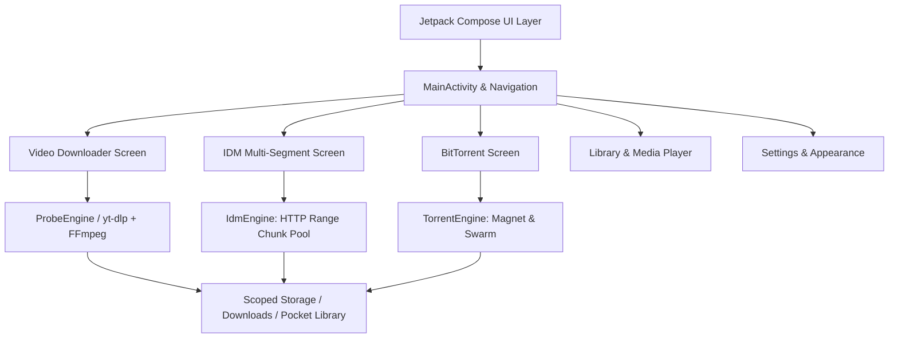

# 🚀 Video Pocket — Master Project Handover & AI Continuity Guide
> **Last Updated:** October 2026 (v0.3.0)  
> **Repository:** `https://github.com/Sa4aC3n/Video-pocket` (Public)  
> **Target Platform:** Android 10+ (API 29–36)  
> **Target Architecture:** arm64-v8a, x86_64  

---

## 📌 1. Purpose of This Document / الغرض من هذا التقرير
This document is specifically authored as a **complete engineering handover and single source of truth**. If this chat session ends or you switch to any other AI assistant (Claude, ChatGPT, Cursor, Copilot, Gemini, etc.), you can simply point the AI to this document or paste the prompt in [Section 8](#8-quick-ai-continuity-prompt--برومبت-استئناف-العمل-لأي-ذكاء-صناعي) to resume development instantly without losing any context or architectural decisions.

تم إعداد هذا التقرير ليكون المرجع الهندسي الشامل والنهائي للمشروع؛ بحيث يمكن لأي مطور أو تطبيق ذكاء اصطناعي آخر استئناف العمل فوراً وبنفس مستوى الدقة دون فقدان أي تفاصيل.

---

## 🏗️ 2. Architectural Overview & System Design

Video Pocket is a universal media and file downloading workstation for Android built using 100% modern Jetpack Compose and Kotlin Coroutines.



### Module & Source Directory Map (`app/src/main/java/org/videopocket/probe/`):
- 📁 **`ui/`** (Modern Presentation Layer):
  - `MainActivity.kt`: Root container, TopAppBar with Settings gear icon, 1-tap Theme toggle (☀️ Light / 🌙 Dark) and Language switcher (🇺🇸 EN / 🇪🇬 AR), bottom navigation bar connecting all engines.
  - `VideoPocketTheme.kt`: Comprehensive Material 3 design system with vibrant Light mode and AMOLED Deep Navy Dark mode (`#0A0E1A`).
  - `HomeScreen.kt`: Multi-platform video downloader (YouTube, Facebook, TikTok, Instagram, Twitter/X, Reddit, etc.) with URL analyzer, format selector, and live progress.
  - `IdmScreen.kt`: Dedicated IDM section featuring direct URL inspection, parallel thread selector (1–16 segments), live segment block visualizer, category filtering, and speed meters.
  - `TorrentScreen.kt`: BitTorrent workstation with Magnet URI parser, `.torrent` file picker, active swarm dashboard (Seeds, Peers, Share Ratio), and upload/download meters.
  - `DownloadsScreen.kt`: Active queues, pause/resume/cancel controllers, and retry handlers.
  - `LibraryScreen.kt`: Categorized downloaded media browser with integrated preview and file share intents.
  - `SettingsScreen.kt`: Compression presets, video quality ceilings, thread limits, storage manager, and native Google Play developer apps showcase.
- 📁 **`idm/`** (Internet Download Manager Engine):
  - `IdmModels.kt`: `IdmTask`, `IdmSegment`, `IdmState`, `IdmCategory` (Video, Audio, Archive, Document, App, Other) with formatting helpers.
  - `IdmEngine.kt`: Multi-segment concurrent chunk downloader utilizing HTTP `Range: bytes=X-Y` requests, sliding-window speed calculation, and atomic segment reassembly.
- 📁 **`torrent/`** (BitTorrent Client Engine):
  - `TorrentModels.kt`: `TorrentTask`, `TorrentState`, `TorrentFileEntry`, swarm metrics.
  - `TorrentEngine.kt`: Magnet URI parser (xt, dn, tr params), pure Kotlin `BencodeDecoder`, tracker announce and peer scraping.
- 📁 **`engine/` & `processing/`** (Core Video & Media Pipeline):
  - Native `libffmpeg.so` and Python-based `yt-dlp` runtime wrappers.
  - `SmartPublicResolver.kt`: Deep link parsing and audio/video stream extraction.
  - `LocalMediaProcessor.kt`: Video transcoding, trimming, audio extraction, and compression.

---

## 🔒 3. Google Play Store Compliance & Policies
1. **Foreground Service Removal:**
   - Previous versions used `DownloadForegroundService` which required `FOREGROUND_SERVICE` and `FOREGROUND_SERVICE_DATA_SYNC` permissions.
   - To ensure 100% compliance with Google Play Developer Policies and avoid automated app rejection, the foreground service and data-sync permissions were **completely removed** from `AndroidManifest.xml`.
   - Downloads now utilize coroutine-based background dispatchers (`Dispatchers.IO`) managed within the app lifecycle.
2. **Android App Bundle (`.aab`):**
   - Google Play Console strictly requires `.aab` (Android App Bundle) for new apps.
   - Built via `./gradlew bundleRelease` for Google Play upload.

---

## ⚡ 4. R8 Full Mode, Shrinking & DEX Optimizations
In `gradle.properties`:
```properties
android.enableR8.fullMode=true
```
In `app/build.gradle.kts`:
```kotlin
buildTypes {
    release {
        isMinifyEnabled = true
        isShrinkResources = true
        proguardFiles(
            getDefaultProguardFile("proguard-android-optimize.txt"),
            "proguard-rules.pro"
        )
    }
}
```
In `app/proguard-rules.pro`:
- `-optimizationpasses 5`: Multi-round aggressive dead-code elimination.
- `-allowaccessmodification`: Inlines and broadens access flags across packages.
- Keep rules specifically tuned for:
  - Jetpack Compose runtime & compiler intrinsics
  - yt-dlp & FFmpeg JNI reflection bridges
  - Jackson JSON serialization models
  - IDM and Torrent data classes
  - Commons Compress & JNA wrappers

---

## 🔑 5. Release Signing Configuration
All hardcoded signing keys and passwords have been removed from the repository. The project builds clean, unsigned release artifacts (`app-release-unsigned.apk` and `app-release.aab`), allowing developers to:
- Use **Google Play App Signing** (Google manages and signs the delivery keys automatically).
- Or sign locally with an external private keystore when required using `apksigner` / `jarsigner`.

---

## 📦 6. Local Artifacts & Releases
Built release packages are placed in the `bin/` directory:
1. `VideoPocket-release.aab` — Production App Bundle for Google Play Console upload.
2. `VideoPocket-release.apk` — Release APK for direct installation/sideloading.

---

## 🛠️ 7. CI/CD & Automated Cloud Build Workflow
The repository utilizes **GitHub Actions** (`.github/workflows/android.yml`):
- Runs on Ubuntu latest with Temurin JDK 17 and Android SDK 36.
- Executes:
  ```bash
  bash gradlew testDebugUnitTest assembleDebug assembleDebugAndroidTest assembleRelease bundleRelease lintDebug lintRelease
  ```
- Verifies 16KB ELF page alignment (`node scripts/check-native.mjs`).
- Uploads verified artifacts (`.aab`, `.apk`, test results, lint reports) on every push to `main`.

---

## 💬 8. Quick AI Continuity Prompt / برومبت استئناف العمل لأي ذكاء صناعي
Copy and paste the prompt below into any AI assistant to continue working seamlessly:

```text
Hello! I am continuing development on "Video Pocket" (https://github.com/Sa4aC3n/Video-pocket).
Please read `docs/AI_DEVELOPER_HANDOVER.md` in the repository as your primary reference.

Key context:
1. Tech Stack: Kotlin, Jetpack Compose, Material 3, Coroutines, yt-dlp + FFmpeg runtime.
2. Architecture: Single-activity Compose app with 6 core sections: Videos, IDM, Torrent, Queue, Pocket, Settings.
3. Package ID: Permanently locked to `org.videopocket.probe`.
4. Google Play Compliance: No foreground services or restricted data sync permissions.
5. Signing: Keystore removed from code; uses standard unsigned release outputs / Google Play App Signing.
6. R8 full mode and ProGuard optimization passes are fully configured.
7. The CI/CD pipeline builds both `assembleRelease` (.apk) and `bundleRelease` (.aab) automatically.

Please confirm you understand the architecture, then tell me what you'd recommend we work on next.
```
